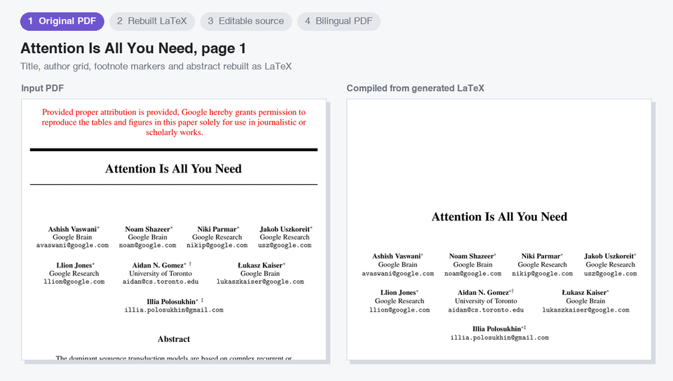
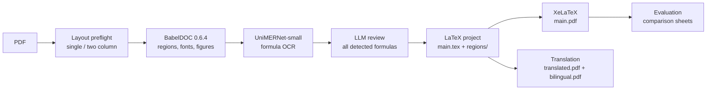

<div align="center">

# PaperReTeX

**Turn academic PDFs back into editable LaTeX, then translate them into side-by-side bilingual PDFs.**

English · [简体中文](README.zh-CN.md)




<sub>Demo: <i>Attention Is All You Need</i> (arXiv:1706.03762). Original PDF → rebuilt from generated LaTeX → Chinese translation.</sub>

</div>

---

PaperReTeX reads a PDF that has a native text layer and rebuilds it as an ordinary
LaTeX project: `\section`, paragraphs, `equation`, figures and tables, laid out by
page and column like the source. Every detected formula is OCR'd locally and then
checked by an LLM against the cropped image, so OCR guesses never pass as confirmed math.
The generated project can then be translated into a Chinese PDF and a side-by-side
bilingual PDF.

The pipeline works only from the input PDF. It does **not** fetch the author's
original source (there is an explicit, separate `--mode source` for that).

## Contents

- [Highlights](#highlights)
- [How it works](#how-it-works)
- [Demo results](#demo-results)
- [Dependencies](#dependencies)
- [Installation](#installation)
- [Usage](#usage)
- [Web app](#web-app)
- [Output](#output)
- [Privacy and network access](#privacy-and-network-access)
- [Development](#development)
- [Limitations](#limitations)

## Highlights

- **Editable, structured output.** `main.tex` assembles one `regions/*.tex` file per
  page region. Text stays as real paragraphs; figures and tables are kept as vector PDFs.
- **Every detected formula is reviewed.** UniMERNet proposes LaTeX for each formula crop;
  Codex CLI or Claude Code compares it with the image and returns
  `confirmed`, `corrected`, `text` (not math, such as a citation or bullet, so the PDF's
  own text is used) or `uncertain`. Anything still uncertain after two rounds is
  rendered as a visible `[?]` placeholder with a traceable ID.
- **Layout aware.** Single- or two-column detection, page size, margins, font sizes,
  fonts and spacing are estimated from the PDF.
- **Auditable and resumable.** Every stage writes its inputs, prompts, responses and
  timings. `--resume` reuses finished work; failed LLM batches are never retried silently.
- **Translation and bilingual PDF.** Batched translation keeps math, commands, citation
  keys and image paths intact, and produces `translated.pdf` and a landscape A3
  `bilingual.pdf` aligned by paragraph and float.
- **Local web app.** Drop a PDF in the browser, choose options and download the
  translated and bilingual PDFs; jobs are queued and kept across restarts.
- **Built-in evaluation.** Page-by-page visual comparisons, pixel diffs, coverage
  metrics and figure-placement checks.

## How it works



1. **Preflight** samples up to 6 pages and asks the selected CLI to classify the layout
   (or uses local geometry only with `--layout-review local`).
2. **BabelDOC 0.6.4** extracts regions, paragraphs, fonts and formula areas, and keeps
   figures and tables as vector assets.
3. **MinerU 2.7.1's UniMERNet-small** OCRs only the formula crops. Fragments inside vector
   figures or page decorations are skipped, because that text stays in the graphic.
4. **LLM review** checks every detected expression in batches (36 per call by default).
   A second round looks only at uncertain items, with the target boxed in red and
   nearby text as context.
5. **LaTeX assembly** follows the original pages, columns and full-width floats.
6. **XeLaTeX** compiles the project and **evaluation** compares it with the source page by page.

## Demo results

The demo GIF comes from a full run on _Attention Is All You Need_ (15 pages) on an
Apple M2 laptop with Codex CLI as the reviewer:

| Metric                                                             | Result                                                                           |
| ------------------------------------------------------------------ | -------------------------------------------------------------------------------- |
| Pages (source → rebuilt)                                           | 15 → 15, XeLaTeX compile passed, no missing glyphs                               |
| Detected formula fragments                                         | 605                                                                              |
| Skipped (inside vector figures or page decorations, never emitted) | 400                                                                              |
| Reviewed by the LLM                                                | 205: 33 confirmed, 80 corrected, 92 non-math text, **0 uncertain**               |
| LLM calls for review                                               | 7 (6 first-round batches + 1 context batch)                                      |
| Word coverage vs. source                                           | 97.2 %                                                                           |
| Column frames scaled > 3 % to fit                                  | 1 of 15 (page 10, 4.5 %)                                                         |
| Wall time                                                          | about 10 minutes, mostly LLM review                                              |
| Translation                                                        | 412 text fragments in 2 LLM calls; `translated.pdf` and `bilingual.pdf` compiled |

Word coverage is a proxy and is not a measure of mathematical correctness.
Reproduce it with the commands in [Usage](#usage).

## Dependencies

PaperReTeX keeps the main package small. The heavy model stacks live in two isolated
virtual environments under your user cache, so they never conflict with the main
environment or end up in the wheel.

### Main package (Python ≥ 3.9)

| Package                   | Purpose                                  |
| ------------------------- | ---------------------------------------- |
| `PyMuPDF>=1.26.5`         | PDF reading, page rendering and cropping |
| `pypdf>=5`                | PDF page handling                        |
| `fonttools>=4.50`         | Font analysis                            |
| `numpy>=1.23`             | Geometry and pixel metrics               |
| `Pillow>=9`               | Image processing                         |
| `pytest>=8` (`dev` extra) | Tests                                    |

### Isolated runtimes (`paperretex install-runtimes`)

Installed into `~/.cache/paperretex/` (or `$XDG_CACHE_HOME/paperretex/`) from the lock files in
[`src/paperretex/data/`](src/paperretex/data/).

| Runtime     | Python | Key packages                                                                                                        | Lock file                                  |
| ----------- | ------ | ------------------------------------------------------------------------------------------------------------------- | ------------------------------------------ |
| Layout      | 3.12   | `babeldoc==0.6.4` (pinned exactly; internal APIs are used), `pymupdf`, `onnxruntime`, `opencv-python-headless`      | `babeldoc-requirements.lock` (84 packages) |
| Formula OCR | 3.11   | `mineru[pipeline]==2.7.1` (UniMERNet-small), `torch`, `torchvision`, `transformers`, `doclayout-yolo`, `modelscope` | `ocr-requirements.lock` (111 packages)     |

You can point to existing environments with `--babeldoc-python` and `--ocr-python`.

### External tools

| Tool                                                                                                                                           | Required for                                              |
| ---------------------------------------------------------------------------------------------------------------------------------------------- | --------------------------------------------------------- |
| [uv](https://docs.astral.sh/uv/)                                                                                                               | Creating environments and installing runtimes             |
| [Codex CLI](https://developers.openai.com/codex/cli/) **or** [Claude Code](https://docs.anthropic.com/en/docs/claude-code/overview), logged in | Layout preflight, formula review (always) and translation |
| XeLaTeX ([TeX Live](https://tug.org/texlive/) or [MacTeX](https://tug.org/mactex/))                                                            | `--compile`, `--evaluate` and `translate`                 |
| `git`, Node.js `npx`, `shfmt`                                                                                                                  | Development only: `scripts/format_project.py`             |

### LaTeX packages and fonts

A full TeX Live / MacTeX installation already includes everything below.

- **Packages:** `fontspec`, `unicode-math`, `amsmath`, `amssymb`, `geometry`, `graphicx`,
  `xcolor`, `caption`, `titlesec`, `enumitem`, `booktabs`, `longtable`, `multirow`, `array`,
  `cuted`, `eso-pic`, `indentfirst`, `pifont`; translation also needs `xeCJK` and `paracol`.
- **Fonts:** TeX Gyre Termes and Linux Libertine (reconstruction); Fandol Song/Hei/Kai/Fang
  (Chinese translation).

## Installation

```sh
git clone https://github.com/JensynLo/PaperReTeX.git
cd PaperReTeX

uv venv --python 3.11 .venv
source .venv/bin/activate
uv pip install -e ".[dev]"

paperretex install-runtimes   # isolated BabelDOC + formula OCR environments
paperretex doctor             # check runtimes, XeLaTeX, codex / claude
```

The first OCR run downloads the UniMERNet model from ModelScope. Set
`MINERU_MODEL_SOURCE=huggingface` to use Hugging Face instead.

## Usage

### 1. Reverse a PDF into LaTeX

```sh
paperretex convert paper.pdf --compile --evaluate -o output/paper
```

This is exactly how the demo above was produced:

```sh
curl -L -o attention.pdf https://arxiv.org/pdf/1706.03762v7
paperretex convert attention.pdf --compile --evaluate -o output/attention
```

### 2. Translate and build the bilingual PDF

```sh
paperretex translate output/paper/main-flat.tex -o output/paper-zh
```

Translation reads `main-flat.tex`, the single-file version of the project. The default
target is Simplified Chinese; change it with `--target`.

### 3. Other commands

```sh
paperretex inspect paper.pdf -o output/layout.json          # layout preflight only, no OCR
paperretex evaluate paper.pdf rebuilt.pdf -o output/compare  # compare any two PDFs
paperretex doctor                                            # environment report
```

### Choosing the LLM

Codex CLI is the default. Switch every LLM step (preflight, formula review, translation) to Claude Code with:

```sh
paperretex convert paper.pdf --llm-provider claude --compile -o output/paper-claude
paperretex translate output/paper/main-flat.tex --llm-provider claude -o output/paper-zh
```

`--llm-command` sets a custom executable. With Codex, `--codex-effort low|medium|high|xhigh|max|ultra`
sets the reasoning effort. Each effort level has its own cache, so you cannot `--resume`
an existing run with a different effort.

### Useful options

| Option                         | Default  | Description                                                                        |
| ------------------------------ | -------- | ---------------------------------------------------------------------------------- |
| `--pages 1-3,5`                | all      | 1-based page selection                                                             |
| `--compile` / `--evaluate`     | off      | Compile with XeLaTeX / write comparison sheets (`--evaluate` requires `--compile`) |
| `--layout-review codex\|local` | provider | `local` skips the LLM preflight; formulas are still reviewed                       |
| `--layout-profile`             | `auto`   | Force `single_column` or `two_column`                                              |
| `--formula-batch-size`         | `36`     | Expressions per review call (1–48)                                                 |
| `--formula-review-rounds`      | `2`      | `1` disables the context round for uncertain items                                 |
| `--formula-timeout`            | `600`    | Seconds per review call                                                            |
| `--resume`                     | off      | Continue an interrupted run in the same output directory                           |
| `--retry-formulas`             | off      | Explicitly retry failed review batches (with `--resume`)                           |
| `--mode`                       | `hybrid` | `semantic`, `reflow`, `layout` and `source` are legacy or comparison pipelines     |

The output directory must be empty on the first run. `--resume` rebuilds generated TeX
files, so copy any hand edits elsewhere first.

## Web app

For day-to-day use, run the local web app and keep it open:

```sh
python app.py --port 8765          # from a checkout; same as: paperretex serve --port 8765
```

Open <http://localhost:8765>, drop a PDF, choose the options and press **Start**. Each job
runs `convert` and then `translate`, shows its stage, progress and log, and offers:

| Download       | Content                                                               |
| -------------- | --------------------------------------------------------------------- |
| Bilingual PDF  | Original and translation side by side, aligned by paragraph and float |
| Translated PDF | The translation alone                                                 |
| Rebuilt PDF    | The original rebuilt from generated LaTeX                             |
| LaTeX project  | `main.tex`, `regions/`, `assets/` and the audit reports as a `.zip`   |

The form covers output (translate or LaTeX only), target language, Codex or Claude, page
range and layout; **Advanced options** has the reasoning effort, LLM or local layout check,
review batch size, rounds and timeouts, and the translation chunk size. The header shows
whether Codex, Claude, XeLaTeX and the OCR runtimes were found.

- Jobs run one at a time, because OCR and LLM review are heavy. They are stored in
  `~/.cache/paperretex/web/` (change it with `--workdir`) and are still listed after a
  restart; a job that was interrupted can be **resumed** and reuses finished stages.
- **Cancel** stops the running command and the LLM CLI it started.
- The server listens on `127.0.0.1` only. `--host 0.0.0.0` makes it reachable from other
  computers **without any login**, so anyone who can reach it can spend your LLM quota;
  add `--allow-host NAME:PORT` for the name they use to reach it.
- Start it from a shell where `codex`/`claude` and `xelatex` are on `PATH`.

## Output

```text
output/paper/
├── main.tex              # entry point, \input-s regions/*.tex
├── main-flat.tex         # single-file version for translation
├── regions/*.tex         # editable source, one file per page region
├── main.pdf              # compiled PDF (--compile)
├── assets/               # vector figures and tables
├── formulas.json         # every formula: crop, OCR candidate, review verdict
├── formula-crops/        # formula images
├── formula-review/       # review boards, prompts, responses, call ledger
├── layout-overlays/      # detected regions drawn on the original pages
├── report.json           # page counts, open formulas, frame fit, warnings
├── evaluation.json       # metrics (--evaluate)
├── comparison/           # original vs rebuilt, page by page
└── pixel-comparison/     # original / rebuilt / diff
```

`translate` writes `main.tex`, `translated.pdf`, `bilingual.pdf`, `bilingual/main.tex`,
`translation-report.json` and a resumable `translation-cache/`.

## Privacy and network access

- **LLM calls** send formula crops, OCR candidates and nearby text (conversion) or TeX
  text chunks (translation) to the provider of the CLI you selected. Your CLI's account
  and model settings apply.
- **Model downloads** happen on the first OCR run (ModelScope by default) and may also
  happen on BabelDOC's first run.
- **arXiv** is contacted only with the explicit `--mode source`. The default pipeline never
  downloads the paper's source.

## Development

```sh
python -m pytest -q                       # no real LLM or OCR calls
python -m compileall -q src/paperretex scripts
python scripts/format_project.py          # Ruff, Prettier, Taplo, shfmt
python scripts/format_project.py --check
python scripts/reverse_samples.py         # full reverse + evaluation on local samples/
```

```text
app.py            starts the web app (python app.py --port 8765)
src/paperretex/   CLI, web app, layout, OCR, formula review, LaTeX, translation, evaluation
scripts/          runtime install, sample evaluation, formatting
tests/            automated tests
docs/assets/      README media
samples/, output/ local PDFs and results (git-ignored)
```

## Limitations

- Hybrid mode needs a native text layer, unrotated pages and CropBox = MediaBox.
  Scanned documents are not supported yet.
- Review coverage counts **detected** formulas. It is not a recall rate for every formula
  in the paper. Text and formulas inside figures and tables stay in the vector assets.
- Tables are not rebuilt as editable `tabular` yet. References stay as text, and
  cross-references are only partly recovered.
- Pixel-exact page reproduction is not a goal. Fonts, line breaks, spacing and complex
  layouts still need human review, and a clean compile does not mean the math is correct.
- The bilingual PDF is re-typeset from the original and translated TeX, so it does not
  match the original PDF page for page.
