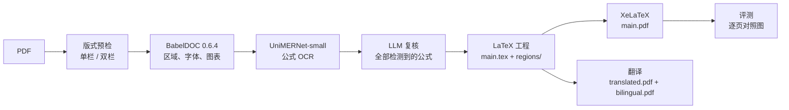

<div align="center">

# PaperReTeX

**把学术 PDF 逆向为可编辑的 LaTeX 工程，并翻译成左右对照的双语 PDF。**

[English](README.md) · 简体中文


<sub>示例：<i>Attention Is All You Need</i>（arXiv:1706.03762）。原 PDF → 由生成的 LaTeX 重新编译 → 中文翻译。</sub>

</div>

---

PaperReTeX 读取带原生文字层的 PDF，把它重建为普通的 LaTeX 工程：`\section`、段落、`equation`、图和表，并按原文的页面与分栏排布。检测到的每个公式都先在本地 OCR，再由 LLM 对照公式裁图复核，OCR 的猜测不会被当作已确认的公式。生成的工程还可以翻译为中文 PDF 和左右对照 PDF。

整个流程只依据输入的 PDF，**不会**下载论文作者的原始源码（需要源码时可以显式使用独立的 `--mode source`）。

## 目录

- [特性](#特性)
- [工作流程](#工作流程)
- [示例效果](#示例效果)
- [依赖](#依赖)
- [安装](#安装)
- [使用](#使用)
- [输出](#输出)
- [隐私与网络访问](#隐私与网络访问)
- [开发](#开发)
- [当前限制](#当前限制)

## 特性

- **可编辑的结构化输出**：`main.tex` 按页面区域引入 `regions/*.tex`。正文是真实段落，图和表保留为矢量 PDF。
- **检测到的公式全部复核**：UniMERNet 先给出每个公式裁图的 LaTeX 候选，再由 Codex CLI 或 Claude Code 对照图片判定为 `confirmed`、`corrected`、`text`（不是数学内容，例如引用或列表符号，直接使用 PDF 原文）或 `uncertain`。两轮后仍不确定的公式显示为 `[?]` 占位符，并带有可追溯的 ID。
- **还原版式**：从 PDF 估计单栏或双栏、页面尺寸、页边距、字号、字体和间距。
- **可审计、可续跑**：每个阶段都记录输入、提示词、响应和耗时。`--resume` 复用已完成的结果，失败的 LLM 批次不会被悄悄重试。
- **翻译与对照 PDF**：批量翻译时保留公式、命令、引用键和图片路径，生成 `translated.pdf` 和按段落、图表对齐的横向 A3 `bilingual.pdf`。
- **内置评测**：逐页视觉对照、像素差异、内容覆盖率和图片位置检查。

## 工作流程



1. **预检**：最多抽取 6 页，让所选 CLI 判断版式；使用 `--layout-review local` 时只做本地几何判断。
2. **BabelDOC 0.6.4**：提取区域、段落、字体和公式范围，并把图表保留为矢量资源。
3. **MinerU 2.7.1 的 UniMERNet-small**：只对公式裁图做 OCR。位于矢量图或页面装饰中的片段会被跳过，因为这些文字保留在图形里。
4. **LLM 复核**：分批检查所有检测到的表达式，默认每次调用 36 个。第二轮只处理不确定项，用红框标出目标，并附上附近正文。
5. **组装 LaTeX**：按原文的页面、栏和跨栏浮动体组织源码。
6. **XeLaTeX 编译**后，**评测**逐页与原文比较。

## 示例效果

上方 GIF 来自对 _Attention Is All You Need_（15 页）的完整运行，设备为 Apple M2 笔记本，复核使用 Codex CLI：

| 指标                                     | 结果                                                                          |
| ---------------------------------------- | ----------------------------------------------------------------------------- |
| 页数（原文 → 重建）                      | 15 → 15，XeLaTeX 编译通过，无缺字                                             |
| 检测到的公式片段                         | 605                                                                           |
| 跳过（位于矢量图或页面装饰中，不会输出） | 400                                                                           |
| 经 LLM 复核                              | 205：确认 33、修正 80、判定为非数学文字 92，**不确定 0**                      |
| 复核调用次数                             | 7（第一轮 6 批 + 上下文复核 1 批）                                            |
| 与原文的词覆盖率                         | 97.2%                                                                         |
| 为容纳内容缩放超过 3% 的栏框             | 15 个中 1 个（第 10 页，4.5%）                                                |
| 总耗时                                   | 约 10 分钟，主要用于 LLM 复核                                                 |
| 翻译                                     | 412 个文字片段，2 次 LLM 调用；`translated.pdf` 与 `bilingual.pdf` 均编译通过 |

词覆盖率只是参考指标，不代表数学内容正确。按[使用](#使用)中的命令即可复现。

## 依赖

主程序依赖很少。较重的模型环境安装在用户缓存下的两个独立虚拟环境中，不会与主环境冲突，也不会打包进 wheel。

### 主程序（Python ≥ 3.9）

| 包                            | 用途                     |
| ----------------------------- | ------------------------ |
| `PyMuPDF>=1.26.5`             | 读取 PDF、渲染页面与裁图 |
| `pypdf>=5`                    | 处理 PDF 页面            |
| `fonttools>=4.50`             | 分析字体                 |
| `numpy>=1.23`                 | 几何计算与像素指标       |
| `Pillow>=9`                   | 图像处理                 |
| `pytest>=8`（`dev` 可选依赖） | 测试                     |

### 独立运行环境（`paperretex install-runtimes`）

按 [`src/paperretex/data/`](src/paperretex/data/) 中的锁文件安装到 `~/.cache/paperretex/`（或 `$XDG_CACHE_HOME/paperretex/`）。

| 环境     | Python | 主要包                                                                                                               | 锁文件                                  |
| -------- | ------ | -------------------------------------------------------------------------------------------------------------------- | --------------------------------------- |
| 版面     | 3.12   | `babeldoc==0.6.4`（使用了内部接口，版本必须严格固定）、`pymupdf`、`onnxruntime`、`opencv-python-headless`            | `babeldoc-requirements.lock`（84 个包） |
| 公式 OCR | 3.11   | `mineru[pipeline]==2.7.1`（UniMERNet-small）、`torch`、`torchvision`、`transformers`、`doclayout-yolo`、`modelscope` | `ocr-requirements.lock`（111 个包）     |

也可以用 `--babeldoc-python` 和 `--ocr-python` 指定已有的环境。

### 外部工具

| 工具                                                                                                                                         | 用途                                      |
| -------------------------------------------------------------------------------------------------------------------------------------------- | ----------------------------------------- |
| [uv](https://docs.astral.sh/uv/)                                                                                                             | 创建环境、安装独立运行环境                |
| 已登录的 [Codex CLI](https://developers.openai.com/codex/cli/) **或** [Claude Code](https://docs.anthropic.com/en/docs/claude-code/overview) | 版式预检、公式复核（必需）与翻译          |
| XeLaTeX（[TeX Live](https://tug.org/texlive/) 或 [MacTeX](https://tug.org/mactex/)）                                                         | `--compile`、`--evaluate` 和 `translate`  |
| `git`、Node.js 的 `npx`、`shfmt`                                                                                                             | 仅开发时使用：`scripts/format_project.py` |

### LaTeX 宏包与字体

完整安装的 TeX Live 或 MacTeX 已包含以下全部内容。

- **宏包**：`fontspec`、`unicode-math`、`amsmath`、`amssymb`、`geometry`、`graphicx`、`xcolor`、`caption`、`titlesec`、`enumitem`、`booktabs`、`longtable`、`multirow`、`array`、`cuted`、`eso-pic`、`indentfirst`、`pifont`；翻译还需要 `xeCJK` 和 `paracol`。
- **字体**：TeX Gyre Termes 和 Linux Libertine（逆向）；Fandol 宋体、黑体、楷体、仿宋（中文翻译）。

## 安装

```sh
git clone https://github.com/JensynLo/PaperReTeX.git
cd PaperReTeX

uv venv --python 3.11 .venv
source .venv/bin/activate
uv pip install -e ".[dev]"

paperretex install-runtimes   # 安装 BabelDOC 和公式 OCR 的独立环境
paperretex doctor             # 检查运行环境、XeLaTeX、codex / claude
```

首次 OCR 会从 ModelScope 下载 UniMERNet 模型。设置 `MINERU_MODEL_SOURCE=huggingface` 可改用 Hugging Face。

## 使用

### 1. 将 PDF 逆向为 LaTeX

```sh
paperretex convert paper.pdf --compile --evaluate -o output/paper
```

上面的示例就是这样生成的：

```sh
curl -L -o attention.pdf https://arxiv.org/pdf/1706.03762v7
paperretex convert attention.pdf --compile --evaluate -o output/attention
```

### 2. 翻译并生成对照 PDF

```sh
paperretex translate output/paper/main-flat.tex -o output/paper-zh
```

翻译读取工程的单文件版本 `main-flat.tex`。默认译为简体中文，可用 `--target` 修改目标语言。

### 3. 其他命令

```sh
paperretex inspect paper.pdf -o output/layout.json          # 只做版式预检，不运行 OCR
paperretex evaluate paper.pdf rebuilt.pdf -o output/compare  # 比较任意两份 PDF
paperretex doctor                                            # 环境检查
```

### 选择 LLM

默认使用 Codex CLI。下面的参数会把所有 LLM 步骤（预检、公式复核、翻译）切换为 Claude Code：

```sh
paperretex convert paper.pdf --llm-provider claude --compile -o output/paper-claude
paperretex translate output/paper/main-flat.tex --llm-provider claude -o output/paper-zh
```

`--llm-command` 可指定自定义的可执行文件。使用 Codex 时，可以用 `--codex-effort low|medium|high|xhigh|max|ultra` 设置推理强度。不同强度使用各自的缓存，因此不能换一个强度去 `--resume` 已有的运行。

### 常用参数

| 参数                           | 默认值   | 说明                                                                  |
| ------------------------------ | -------- | --------------------------------------------------------------------- |
| `--pages 1-3,5`                | 全部     | 页码从 1 开始                                                         |
| `--compile` / `--evaluate`     | 关闭     | 用 XeLaTeX 编译 / 生成对照图（`--evaluate` 需要同时指定 `--compile`） |
| `--layout-review codex\|local` | 所选 CLI | `local` 跳过 LLM 预检，公式仍会复核                                   |
| `--layout-profile`             | `auto`   | 强制 `single_column` 或 `two_column`                                  |
| `--formula-batch-size`         | `36`     | 每次复核调用的表达式数（1–48）                                        |
| `--formula-review-rounds`      | `2`      | 设为 `1` 时不做不确定项的第二轮上下文复核                             |
| `--formula-timeout`            | `600`    | 每次复核调用的超时秒数                                                |
| `--resume`                     | 关闭     | 在同一输出目录继续被中断的运行                                        |
| `--retry-formulas`             | 关闭     | 显式重试失败的复核批次（需配合 `--resume`）                           |
| `--mode`                       | `hybrid` | `semantic`、`reflow`、`layout`、`source` 是旧流程或对照流程           |

首次运行时输出目录必须为空。`--resume` 会重新生成 TeX 文件，如有手工修改请先另存。

## 输出

```text
output/paper/
├── main.tex              # 入口，\input regions/*.tex
├── main-flat.tex         # 单文件版本，供翻译使用
├── regions/*.tex         # 可编辑源码，每个页面区域一个文件
├── main.pdf              # 编译结果（--compile）
├── assets/               # 矢量图与表格
├── formulas.json         # 每个公式的裁图、OCR 候选与复核结论
├── formula-crops/        # 公式图片
├── formula-review/       # 复核图板、提示词、响应与调用记录
├── layout-overlays/      # 在原页上画出的检测区域
├── report.json           # 页数、未确认公式、页面框缩放、警告
├── evaluation.json       # 评测指标（--evaluate）
├── comparison/           # 原文与重建结果逐页对照
└── pixel-comparison/     # 原文 / 重建 / 差异
```

`translate` 输出 `main.tex`、`translated.pdf`、`bilingual.pdf`、`bilingual/main.tex`、`translation-report.json`，以及支持续跑的 `translation-cache/`。

## 隐私与网络访问

- **LLM 调用**：转换时会把公式裁图、OCR 候选和附近正文发送给所选 CLI 的服务商；翻译时发送 TeX 文字片段。账号与模型按该 CLI 自身的配置。
- **模型下载**：首次 OCR 时下载模型（默认来自 ModelScope），BabelDOC 首次运行也可能下载资源。
- **arXiv**：只有显式使用 `--mode source` 时才会访问。默认流程不会下载论文源码。

## 开发

```sh
python -m pytest -q                       # 不调用真实 LLM 或 OCR
python -m compileall -q src/paperretex scripts
python scripts/format_project.py          # Ruff、Prettier、Taplo、shfmt
python scripts/format_project.py --check
python scripts/reverse_samples.py         # 对本地 samples/ 完整逆向并评测
```

```text
src/paperretex/   CLI、版面、OCR、公式复核、LaTeX、翻译与评测
scripts/          运行环境安装、样例评测、格式化
tests/            自动测试
docs/assets/      README 使用的媒体文件
samples/、output/ 本地 PDF 与结果（不加入 Git）
```

## 当前限制

- hybrid 模式要求 PDF 有原生文字层、页面未旋转，且 CropBox 与 MediaBox 相同。暂不支持扫描件。
- 复核覆盖率以**检测到的**公式为分母，不代表论文中所有公式的召回率。图表内部的文字和公式保留在矢量资源中。
- 表格暂不能还原为可编辑的 `tabular`。参考文献保留为文本，交叉引用只部分恢复。
- 不追求像素级复刻。字体、断行、间距和复杂版式仍需人工检查；编译通过也不代表公式正确。
- 对照 PDF 由原文和译文 TeX 重新排版，不与原 PDF 逐页对应。
